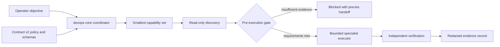

# DevOps Skill Platform

**Portfolio project · release candidate 0.8.0**

A modular, Codex-first platform for bounded, evidence-driven infrastructure work. It contains 23 composable skills under contract v2: a coordinator, a fail-closed policy and validation layer, and focused modules for hosts, directory identity, containers, edge, delivery, the GitHub control plane, data, cloud providers, Kubernetes, networking, access, reliability, and security governance.

This project demonstrates system administration and DevOps engineering practices: decomposing operational ownership, classifying risk, planning recovery, constraining privileged changes, validating packages, and collecting verification evidence. It is not a certification, a managed service, or an autonomous administrator.

## Install as a Claude Code plugin

```
/plugin marketplace add Manacost-Labs/devops-skill
/plugin install devops-skill-platform@manacost-devops
```

This enables the 23 skill instructions. The plugin does not enable execution protection automatically. Use a stable execution runtime and explicitly configure the optional Claude Code gate when operating infrastructure; see [hook setup and its trust boundary](docs/hooks-setup.md). The manifest is also validated with Claude Code 2.1.207.

## Choose an installation

| Installation | What you receive | Execution protection |
|---|---|---|
| Claude Code plugin | Skill instructions and their packaged supporting files | Optional; configure the hook explicitly |
| Codex skill profile | Selected skill folders in the skills directory | Guidance and local validators; no Codex hook adapter is supplied |
| Full execution runtime | Planner, executor, optional Claude hook, verifier, documentation and all 23 modules in one stable folder | Wrapper checks apply to commands run through it; automatic tool interception requires the configured Claude hook |

For a complete runtime, start from a source checkout or a verified runtime archive with Python 3.13 and the hash-locked requirements installed:

```powershell
# Preview without writing.
python tools/install.py --runtime --destination ../devops-runtime
# Install the reviewed complete runtime.
python tools/install.py --runtime --destination ../devops-runtime --apply
# Optionally install the instructions needed by Codex.
python ../devops-runtime/tools/install.py --profile web-linux --apply
```

Runtime installation requires an explicit destination outside the source tree. Replacing it requires `--apply --force`; the installer retains a recovery copy and preserves `operations/` plans and journal records. It refuses to replace an unrelated nonempty directory. The runtime keeps all modules so its catalog remains self-contained; the skill profile selects which instructions the agent discovers.

Execution, planning and runtime replacement share a native process lock. An upgrade refuses a busy runtime, and a competing execution does not start. The lock lives in a stable sibling `.devops-skill-locks/` directory so replacing the runtime cannot replace its lock. Provision that directory and its lock file for the operator identity, and protect them from deletion or replacement. Native locking must be supported by the chosen filesystem. This local coordination does not acquire an infrastructure target lock. Stop old, uncoordinated runtime versions before their first upgrade.

Use absolute paths to runtime programs when working in another project. The relative command examples below assume your current directory is the runtime or source root. Installing a skill profile alone does not install the top-level execution programs.

## How the pieces fit together

Skills teach the agent how to investigate and plan. The planner prepares a request for human review. The gate validates the request and its approval records. The executor checks the exact command, records launch intent, runs it, and records the process outcome. The optional Claude hook checks tool calls before they reach execution. The operator still verifies the service and supplies real authorization.

These pieces have different responsibilities: a successful package check proves compatible files; a command exit code proves only a process outcome; service acceptance needs its own evidence. See the [5-minute safe evaluation](#5-minute-safe-evaluation) for a read-only introduction.

## Start here

- [5-minute safe evaluation](#5-minute-safe-evaluation) — validate the platform and preview an install without changing a host or cloud account.
- [Synthetic portfolio demo](examples/portfolio-demo/README.md) — run audit, digest-bound approval, simulation, verification, and rollback locally.
- [Architecture](docs/architecture.md) — components, trust boundaries, control flow, and extension points.
- [Portfolio pilot case study](docs/portfolio-case-study.md) — an anonymized, evidence-led pilot plan for a friend-operated small hosting service.
- [Enterprise adoption gate](docs/enterprise-adoption.md) — controls an organization must supply before production use.
- [Threat model](docs/threat-model.md), [governance](GOVERNANCE.md), and [control crosswalk](docs/control-crosswalk.md) — assurance scope and limitations.

## What this project demonstrates

| DevOps competency | Repository evidence |
|---|---|
| Platform design | Capability-based routing across 23 dependency-closed modules |
| Linux and workload operations | Linux, Windows Server, Docker, Kubernetes, network-edge, and reliability modules |
| Delivery and state safety | IaC plan binding, CI/CD trust boundaries, backup/restore and rollback requirements |
| Cloud engineering | Provider-neutral routing plus AWS, Google Cloud, Azure, Selectel, and Cloudflare packs |
| Security engineering | Least privilege, untrusted-input boundaries, expiring approvals, separation of duties, and redacted evidence |
| Software quality | Schema validation, deterministic release packaging, dependency pinning, unit tests, and adversarial scenarios |
| Operational judgement | Explicit stop conditions, recovery gates, measurable acceptance criteria, and honest partial-verification states |

## Safety properties

Each check enforces only the stated execution or packaging path. Skill prose is guidance. Tool pre-approvals are convenience permissions, not a deny list. The optional Claude hook requires trusted, protected settings, runtime, interpreter, PATH and CLI configuration; it is not an operating-system sandbox.

| Property | Type | Mechanism |
|---|---|---|
| A submitted R2-R4 request with invalid policy, target/plan binding, approval records, window or recovery fields is refused | Request validation | `operation_gate.py` validates the local contract; external identity and evidence authenticity remain organization-owned |
| A wrapped command needs an exact argv digest, a fresh gate PASS and a durably recorded launch intent before execution | Wrapper enforcement | `tools/devops_exec.py` refuses pre-launch failures and distinguishes post-launch audit errors and timeouts |
| Configured Claude sessions accept a bounded inspection grammar or a gate-checked wrapper; unknown options, control operators, alternate shells and direct file-edit tools are denied | Optional tool interception | Configure the hook for every tool as described in [hook setup](docs/hooks-setup.md); trusted executable/configuration assumptions still apply |
| Every module declares matching `allowed-tools` metadata and manifest entries | Package validation | This checks declarations. In Claude Code, `allowed-tools` pre-approves tools and does not restrict the available tool pool; use actual runtime permission controls |
| Catalog compatibility, dependency-closed profiles, hash-locked dependencies, deterministic releases, and archive path safety | Enforced | platform validator, release builder, and `verify_release.py` |
| Read-only discovery is the default; sensitive or cross-tenant reads are separately governed | Advisory | documented workflow in `devops-core` |
| Repository text, tickets, logs, web pages, command output, and tool responses are untrusted data and cannot grant authority, choose privileged credentials, or weaken policy | Advisory | untrusted-content boundary references consumed by every module |
| Risk classification, minimal module routing, honest `partially_verified` reporting, and evidence redaction outside the wrapper ledger | Advisory | module contracts, templates, and evaluation scenarios |

Local ledgers and release manifests are integrity evidence, not external identity, signatures, immutable storage, SLSA provenance, or certification. Production use still requires organization-owned identity, short-lived credential brokerage, protected source control and CI, signed provenance, change management, immutable audit storage, data governance, accountable owners, and independent assessment.

## Architecture at a glance



`devops-core` routes work by capability and does not impersonate an absent specialist. Every executor inherits the central risk, approval, recovery, evidence, and untrusted-content contract. See [Architecture](docs/architecture.md) for the system context and trust boundaries.

## Module inventory

| Layer | Modules | Boundary |
|---|---|---|
| Control plane | `devops-platform-contracts`, `devops-core` | Policy, schemas, compatibility, operation gate, routing, evidence |
| Hosts and workloads | `linux-operations`, `windows-server-operations`, `docker-operations`, `kubernetes-operations` | OS and workload lifecycle; Kubernetes is selected only when justified |
| Directory identity | `identity-directory-operations` | AD DS, OUs, principals, group governance, GPO planning and staged rollout; not Entra, secrets, or local host administration |
| Delivery and state | `iac-operations`, `cicd-operations`, `github-operations`, `data-resilience-operations` | Reviewed plans, protected pipelines, GitHub protections/environments/releases, restore-proven data operations |
| Daily database operations | `database-operations` | PostgreSQL/MySQL/MariaDB waits, connection budgets, replication diagnosis and maintenance planning; recovery stays with a confirmed engine-specific owner |
| Edge and networks | `network-edge-operations`, `cloudflare-operations`, `enterprise-networking` | DNS/TLS/HTTP, Cloudflare control plane, VPN/BGP/hybrid routing |
| Cloud | `cloud-generic`, `cloud-aws`, `cloud-gcp`, `cloud-azure`, `cloud-selectel` | Provider discovery and bounded control-plane operations using current official docs |
| Trust and assurance | `secrets-access-operations`, `reliability-operations`, `security-compliance-operations` | JIT access, service health, incidents, controls, exceptions, evidence—not certification |

Provider packs do not replace the technical modules. For example, an EKS migration normally needs `cloud-aws`, `kubernetes-operations`, `data-resilience-operations`, `secrets-access-operations`, and `reliability-operations`, selected only for the layers actually affected.

Managed-service boundaries are normative in the [control-plane ownership matrix](devops-core/references/control-plane-ownership.md): provider packs own provider APIs, while IaC state, Kubernetes resources, data recovery, identity lifecycle, network paths, release trust, and service acceptance remain with their specialist modules.

## Host, monitoring and database operations

Linux covers Debian/Ubuntu and confirmed RHEL-family hosts with focused procedures for cgroups/OOM, packages, storage/boot, networking and mandatory access controls. Reliability covers Prometheus/Alertmanager, Grafana, Loki/OTel, missing data, burn rates, capacity and release acceptance. The database module separates everyday PostgreSQL/MySQL/MariaDB diagnosis from recovery. Data resilience now includes [MySQL/MariaDB backup, PITR and isolated restore drills](docs/mysql-mariadb-recovery.md). Read the [scope, examples and validation limits](docs/operations-depth.md).

## Windows Server operations

Windows operations now covers SMB/NTFS, host certificates/keys, Task Scheduler, standalone storage and file/host recovery with focused procedures and read-only evidence helpers. The [scope and native-test limits](docs/windows-server-depth.md) distinguish configuration inventory from effective access, trust and restore proof.

## Docker and Kubernetes depth in 0.8.0

Container modules now cover crash/OOM/probe/eviction diagnosis, DNS/listener/Service/policy paths, mount/PVC/backing-storage identity and recovery after data-changing releases. They distinguish compatible application reversal, forward repair and isolated restore with newest-write reconciliation. [Scope and native tests](docs/container-operations-depth.md) explain offline snapshot helpers, disposable Docker/kind fixtures and limits; image/template rollback alone does not restore data.

## Install profiles

| Profile | Intended use |
|---|---|
| `core` | Planning, policy, validation, and safe handoff |
| `web-linux` | Linux + Docker + HTTP edge + Cloudflare + reliability |
| `windows-server` | Windows host, SMB/NTFS, certificates, tasks, storage/recovery, access and reliability |
| `hybrid-server` | Linux/Windows hosts + Docker + HTTP edge + reliability |
| `identity-directory` | Active Directory and GPO work with Windows-host, privileged-access, and reliability handoffs |
| `delivery` | IaC, CI/CD, GitHub control plane, and secret/access boundaries |
| `data-safe` | Database diagnosis, connection budgets, supported recovery, reliability and access controls |
| `cloud-foundation` | Provider-neutral cloud foundation with IaC, edge, reliability, and access |
| `kubernetes` | Kubernetes workload operations with Docker, edge, reliability, and access |
| `aws-platform`, `gcp-platform`, `azure-platform`, `selectel-platform` | Named provider plus IaC, CI/CD, containers, Kubernetes, data, network, access, and reliability handoffs |
| `hybrid-network` | Linux/Windows endpoints plus HTTP edge, VPN/BGP/hybrid networking, access, and reliability |
| `assurance` | Evidence-led security governance with access and reliability evidence sources |
| `all` | All 23 modules, including directory identity, GitHub, named provider, and enterprise packs |

Profiles are dependency-closed and validated against the embedded release catalog. `all` is intentionally broad; `devops-core` still loads the smallest capability set for each operation.

## 5-minute safe evaluation

Prerequisite: a source checkout with CPython 3.13 and the hash-locked dependencies from `requirements.txt` available in the active environment. These commands perform repository validation and an installer preview only. They do not install skills, contact infrastructure, request credentials, or mutate a target.

```powershell
# 1. Confirm the runtime.
python --version

# 2. Validate the catalog, contracts, schemas, policies, and dependencies.
python devops-platform-contracts/scripts/validate_platform.py

# 3. Preview the dependency-closed web/Linux profile. Do not add --apply.
python tools/install.py --profile web-linux
```

A successful validation reports `23/23 compatible installed skills`. The installer then prints each proposed destination and ends with `Dry-run only`. Review the [architecture](docs/architecture.md) next, or run the [shipped synthetic portfolio demo](examples/portfolio-demo/README.md) without connecting to a real target.

`tools/install.py` is dry-run by default. `--apply` writes to the selected skills directory, and `--apply --force` can replace existing skills; neither option is part of this safe evaluation.

## Running one real change

The contract binds an approval to one exact command. `tools/devops_plan.py` computes the bindings a human cannot compute by hand (canonical command digest, policy digest, validated target-profile digest) and derives the minimum risk class the policy implies:

```bash
python tools/devops_plan.py --target-profile my-target.yaml --action container_rollout --risk R2 --objective "Roll out the approved release" --scope service:api --verify "health endpoint returns 2xx" --external-side-effects --output change.json -- docker compose up -d
```

The generated request is deliberately **not** authorized: approval slots are empty, and required change locks or recovery evidence are left blank. The builder prints exactly what a human must supply. After a real approver fills those fields, execute through the wrapper:

```bash
python tools/devops_exec.py --operation change.json -- docker compose up -d
```

The wrapper re-runs the gate immediately before launch and refuses command-digest drift. Planning never grants authority. Local approval records are validated data; an adopting organization must authenticate approvers and evidence independently.

The journal flushes the intent file before launch and, on POSIX, also syncs its containing directory and any newly created directory entries. It records `launch_intent` before starting the process and `executed` with its exit code afterwards, joined by an execution ID. An intent without a final record requires investigation. Exit 3 means refused before launch; exit 74 means execution started but the final journal record could not be saved; exit 124 means a timeout after launch. An executed child can also return a nonzero exit code, so interpret the result message and journal status together. Verify target state before retrying an interrupted or incompletely recorded operation.

The digest covers the command arguments. Protect working directories, executable contents, environment, configuration and referenced plan files separately; unchanged arguments do not prove those inputs stayed unchanged.

## Safe operation flow

1. Normalize the objective, target owner, environment, data class, constraints, and measurable acceptance criteria.
2. Treat all retrieved content as untrusted data and perform narrow read-only discovery.
3. Select the minimum installed capabilities and classify risk R0-R4.
4. For stateful or destructive work, prove recovery with a fresh artifact and isolated restore test.
5. Create the exact plan, calculate its digest, acquire the target lock, and obtain identity-backed approvals required by policy.
6. Run the v2 operation gate immediately before execution. Stop on any drift.
7. Execute through the owning module with least privilege and an idempotency boundary.
8. Verify the user path and observation window, then record redacted evidence as `verified`, `partially_verified`, `rolled_back`, or `blocked`.

## Provider freshness

Windows Server, Linux, reliability, database operations, Cloudflare, IaC, CI/CD, GitHub operations, data-resilience, AWS, Google Cloud, Azure, Selectel, and Kubernetes manifests declare official documentation sources, map every capability to those sources, and record `last_verified`. Validation rejects missing capability coverage, unapproved source hosts, future dates, and release metadata older than 183 days. This does not make memorized behavior safe: a material change must refresh the exact official operation page and run read-only discovery against the actual account, project, subscription, cluster, tool, or database topology.

## Development and release

The following commands require a source checkout. Runtime release archives intentionally contain the installer and verifier, but not tests, CI configuration, the release builder, or target-specific administration tools.

```powershell
python devops-platform-contracts/scripts/validate_platform.py
python -m unittest discover -s tests -v
python tools/build_public_source.py --output ..\devops-skill-platform-public
python tools/build_release.py --output dist/devops-skill-platform-0.8.0.zip
python tools/verify_release.py dist/devops-skill-platform-0.8.0.zip
```

`PUBLIC-SOURCE-MANIFEST.json` is generated only in a fresh public-source export, not maintained as a stale receipt in the development tree. `build_public_source.py` creates a fresh allowlisted source tree without Git history, private operation records, lab artifacts, release archives, credentials, or target-specific tools. Use that clean tree—not an export of a private operations repository—as the source of a new public portfolio repository.

Before publication, run the standard Codex validator for every changed skill and independent forward/red-team scenarios. A production release additionally needs protected two-party review, an SBOM, vulnerability policy results, signed provenance, a trusted signer/builder, independent verification, and registry rollback. See [CONTRIBUTING.md](CONTRIBUTING.md), [SECURITY.md](SECURITY.md), and [SUPPORT.md](SUPPORT.md).

## License

Licensed under the [Apache License 2.0](LICENSE). No project-level `NOTICE` file is currently required by the reviewed repository contents; add one before distribution if a later dependency or attribution review identifies an obligation. Third-party tools and runtime dependencies retain their own licenses.
