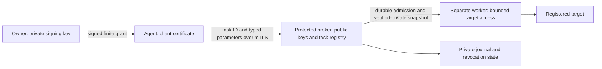

# Protected execution and migration in 0.15

The agent is a requester. A separate Linux broker authenticates it with mutual
TLS and executes only administrator-registered tasks under a third, unprivileged
worker identity. The accountable owner signs finite task grants with an Ed25519
key outside both the agent and the broker. This is an optional, separately
provisioned deployment; installing skills does not establish this boundary.



## What changes

The arbitrary local `devops_exec.py --operation ... -- command` API is removed.
It refuses before launching anything, including apparently read-only commands.
An argv hash cannot establish risk, authenticate an approver, or freeze the
script, environment and credentials behind that command.

The existing planner, operation gate, legacy autonomy JSON and chat cards remain
useful for planning and contract consistency. They **never authorize this broker**.
`PLANNING_SELECTED` means precisely a local preference. Callback stdin, session
IDs, evidence strings, hashes and caller-selected authority directories cannot
mint an execution grant. Pending old approvals must be reviewed and reissued.

## Provision once under an accountable owner

1. Deploy reviewed runtime, interpreter, native libraries, scripts and settings
   under an administrator identity the agent and workers cannot modify. Stop
   legacy direct execution and remove direct infrastructure credentials from the
   agent. A hook is not a sandbox and Full Access under the same privileged UID
   cannot supply this separation. Protect complete ancestor paths, not just files.
2. Provision a separately isolated Linux supervisor, private root-owned `0700`
   state directory and separate root-owned worker scratch parent. Workers must
   be non-root, differ from all agent UIDs and have cleared supplementary groups.
   Do not reuse a worker UID across unrelated target trust domains. Bound network,
   cloud IAM, mounts, namespaces, capabilities and target credentials externally.
   The root supervisor belongs inside that isolated service boundary, not inside
   an agent-controlled environment with production-wide root access.
3. Register the actual policy digest, client certificate fingerprints and stable
   operating principals. Certificate aliases for one principal share revocation.
   Register owner public keys with actor, role, permitted target IDs, maximum
   mode and maximum risk. Keep private issuer keys outside agent and broker access.
4. Register each task's authoritative target/resource, action, risk and effects,
   fixed executable SHA-256, fixed argv, complete code manifest, finite parameter
   and result schemas, worker UID/GID, timeout, recovery and acceptance criteria.
   Only enum values, bounded integers and opaque SHA-256 values are accepted;
   command strings, caller paths, environments and arbitrary payloads are absent.
   Review task code and dependencies: signed registration does not prove them safe.
5. Provision server certificate/key and approved client CA, plus an agent client
   certificate/key with no target or signing privileges. Use a strict HTTPS origin
   and protected client profile. The client ignores proxy environment settings,
   follows no redirects and verifies server identity before sending a grant.
6. Start `tools/broker_server.py --config /absolute/protected/service.json` under
   the isolated supervisor. Missing/weak deployment prerequisites fail closed.
   Use the schemas and synthetic fixture as shape examples, not as production
   credentials or a ready-made deployment. Config keys are `registry`,
   `bundle_dir`, `state_dir`, `worker_dir`, `host`, `port`, `certificate`,
   `private_key`, `client_ca`, and nonempty `agent_uids` / `agent_gids` (including agent supplementary groups).
7. Establish acceptance, backup, reconciliation and retention procedures before
   admitting stateful tasks. All target writers must share the relevant external
   coordination boundary; the broker lock cannot lock a second unrelated broker.

The broker registry is validated by `broker_contract.py`; its exact keys are
`schema_version`, `server_id`, `policy`, `policy_digest`, `keys`, `clients`,
`targets` and `tasks`. Client entries contain `principal` and an initial random
64-hex `epoch`. The synthetic `tests/broker_fixture.py` demonstrates complete
records without storing any actual key or active authority in the repository.

## One authorization, many ordinary steps

The agent prepares the intended mode, target and registered task set. An owner
reviews that concrete scope once and signs a grant binding the broker audience,
registry digest, mTLS certificate fingerprint, current broker epoch, mode, task
IDs, finite validity window and operation count. Full Auto additionally requires
real isolation, credential scope and owner evidence. Every launch still checks
the policy; signatures cannot override hard denials or missing recovery proof.

An external issuer may use `tools/devops_authorize.py --candidate ...
--private-key ... --key-id ... --output ...` in its own protected environment.
This helper signs candidate bytes; it does not establish human consent, install
keys, renew authority or prove that the candidate matches the actual broker.
Never expose it or its key to the agent. Broker `describe`/`prepare` responses
provide current registry/epoch/call bindings to the authorized owner workflow.

The client profile contains only `url`, absolute `ca_file`,
`client_certificate`, `client_private_key` and `timeout_seconds` (1–330).
Keep its private key and grants out of source/export/logs. A typed call is:

```json
{"schema_version":"1.0","operation_id":"ops-example-0001","task_id":"registered-task","parameters":{}}
```

```bash
python -I /absolute/runtime/tools/devops_exec.py --broker-config /absolute/runtime/broker-client.json --grant /private/issued-grant.json --request /private/call.json --route prepare
python -I /absolute/runtime/tools/devops_exec.py --broker-config /absolute/runtime/broker-client.json --grant /private/issued-grant.json --request /private/call.json --route execute
```

For above-ceiling, destructive or irreversible work, `prepare` supplies the exact
`call_digest` and `grant_digest`; an independent authorized signer binds a separate
admission to them. The agent cannot edit task risk or target to avoid that step.
Policy may require multiple distinct actors/roles. Both grant and exact admission
have real UTC expiry; no caller clock is accepted.

## Restriction, receipts and recovery

`restrict` with Safe needs only the authenticated client, never a grant or another
confirmation. It records a new random principal-wide epoch independently of the
running-task mutex. Pending restrictions are checked at final admission. Old
grants are reduced to the persisted ceiling; old exact admissions cannot revive
higher-risk work. Restrictions can only lower that ceiling. A fresh owner-signed
grant for the new nonce can authorize its own scope without reviving old grants.
Already admitted workers are not atomically undone: contain/reconcile them.

Before any worker starts, the broker durably records intent and a linked audit
event. A verified root-owned snapshot prevents later source replacement from
changing the launch. The worker gets a new HOME/cwd, fixed environment, no agent
secrets, no supplementary groups and no privilege escalation. Output is bounded;
only registered finite structured results and hashes leave the worker boundary.

An authenticated `status` request takes only the original operation ID and remains
available after grant expiry. Reusing an ID with identical admitted inputs returns
its receipt; different inputs are refused. Never allocate a new ID to conceal an
unknown outcome. Timeout, output overflow, missing/invalid result, failed mutation
or post-launch durability failure retain the target latch. Unclean service restart
is refused pending owner reconciliation. Diagnose actual effects and preserve the
original receipts before restoring service; do not just delete the latch/restart.

CLI exit 0 requires an executed zero-exit task with a valid structured result, or
a successful prepare/restrict/describe. Exit 1 reports a known unsuccessful task;
3 reports refusal; 4 means execution may have happened and needs reconciliation.
Even a valid task result does not prove the application observation window passed.

The local hash-linked audit is private integrity evidence, not external immutable
storage. Policies requiring an independent immutable sink are refused because
this release does not implement that sink. Capacity is finite; owner retention
must preserve outstanding receipts, revocations and unknown outcomes.

## Evidence and limits

Platform 0.16 adds opt-in `worker_input: context-v2` and a Windows PSRP/JEA
foundation. Legacy input remains unchanged. Read [Windows integration and owner
activation](windows-protected-execution.md) for remote journals and evidence limits.

Cross-platform regression tests cover signatures, field injection, mode ceilings,
signer scopes, replay, restriction races, durability failures and native hook wire
format. Dedicated Linux CI uses a pinned read-only container with no network,
synthetic mTLS and actual distinct agent/worker UIDs; it executes real tasks and
checks denied direct access, source replacement, timeout and target quarantine.
Pinned actual Codex CLI tests use a local no-auth synthetic Responses provider,
a positive shell control and a blocked canary on Linux and Windows. These prove
the tested native hook loop, not all desktop/cloud tools or Windows broker ACLs.

No test certifies production task code, kernel containment, organizational IAM,
external audit, actual recovery or every future Codex tool. Review host upgrades
and rerun native checks before claiming enforcement in a deployed environment.
